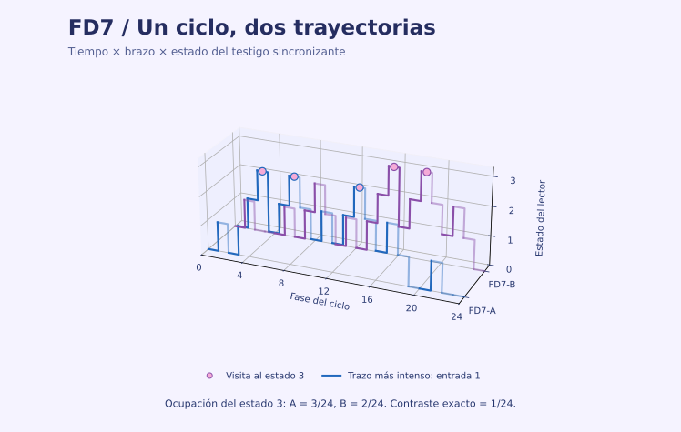

# ChronoWitness

[English](README.md) · [Atlas de evidencia](https://facundofirmenich.github.io/ChronoWitness/?lang=es) · [Descargas](https://github.com/FacundoFirmenich/ChronoWitness/releases)

ChronoWitness diseña entradas temporales emparejadas para contrastar clases de modelos de memoria celular. Las secuencias FD7 coinciden en los conteos de palabras cíclicas hasta el orden siete y satisfacen la identidad declarada para la media periódica de dos estados. Los testigos exactos muestran dónde lectores con más estados distinguen las historias. Los contratos de observación e inferencia especifican cómo interpretar un contraste medido.

## Empezar sin Git

1. Descargá de Releases el ZIP nativo para tu plataforma y extraé toda la carpeta. Hay destinos para Windows x64, Linux x64 y macOS Apple Silicon o Intel. Elegí la arquitectura que figura en el archivo.
2. Abrí `START_HERE.bat` en Windows, `START_HERE.command` en macOS o `START_HERE.sh` en Linux. El ejecutable ChronoWitness de la misma carpeta también abre el menú.
3. Escribí `es todo` para el núcleo público completo, `es 1,3` para seleccionar bloques o `es atlas` para explorar. El paquete nativo guarda los resultados en `source/research/results`.

El paquete nativo incluye Python, dependencias numéricas y motores C++ de la plataforma. La ejecución completa usa esos motores y coteja los resultados con las referencias distribuidas. La ruta desde fuentes comprueba además la compilación desde C++17. Los binarios nativos están sin firmar. Si el sistema no los admite, usá la ruta desde fuentes de la [guía de reproducción](docs/GUIA_ES.md).

| Bloque | Alcance |
|---|---|
| 1 | Identidades exactas de lectores, balance por fase y comprobaciones del instrumento |
| 2 | Reportero finito, entrega, inferencia secuencial, conteos y testigo cinético |
| 3 | Margen de diseño certificado, potencia exacta, ejemplo y controles |
| 4 | Ensayo de trayectorias congelado, Monte Carlo contra referencias independientes e interfaces de aplicación |
| todo | Núcleo público completo y cotejo con las referencias |
| atlas | Mapa sin conexión, lectura guiada, dependencias tipadas y trayectorias exactas FD7 |

## Examinar los resultados y su alcance

- [Guía científica y de reproducción en castellano](docs/GUIA_ES.md), con la identidad exacta, las condiciones de observación, los cálculos y las fuentes.
- [Resultados científicos](docs/RESULTADOS_CIENTIFICOS.md), [ejemplo exacto](docs/EJEMPLO_EXACTO.md), [observaciones celulares](docs/OBSERVACIONES_CELULARES.md) y [reproducción de figuras](docs/REPRODUCCION_DE_FIGURAS.md).
- [Diseño certificado](research/supplement-v011/data/), [campaña de ensayo](research/supplement-v012/data/) y [cierre científico E11](research/e11-causal/CIERRE_SUSTANTIVO_E11_ES.md).
- [Predicción congelada E9](research/e9-execution/E9_NUMERICAL_PROTOCOL.json), [transporte E10](research/e10-transport/README.md) y [adquisiciones reservadas E11](research/e11-causal/README.md).

Los estudios celulares conservan deterioros de cola y jurisdicciones sin soporte. Los programas de entrada publicados difieren de una intervención emparejada FD7/FD8. El núcleo nativo reproduce los certificados y las simulaciones del ensayo. Los estudios de adquisición especifican por separado sus fuentes, dependencias y cómputo.

El atlas distingue un recorrido de lectura de las dependencias científicas. La vista de argumento permite inspeccionar todas las premisas de una conjunción. El testigo 3D muestra fase, brazo y estado. El contraste exacto de ocupación del estado 3 es 1/24.

## Ruta desde fuentes y cita

Usá `Start-Windows.bat`, `Start-macOS.command` o `start-linux.sh` con Python 3.12 para abrir el menú desde fuentes. Para la reproducción canónica completa, iniciá Docker y elegí `es todo`, o ejecutá `python launch.py --mode full`. La [guía de reproducción](docs/GUIA_ES.md) explica las rutas.

Facundo Firmenich, Pau Firmenich y León Firmenich. [Metadatos de cita](CITATION.cff) · [Software v0.14.3 archivado](https://doi.org/10.5281/zenodo.24147203) · [Todas las versiones](https://doi.org/10.5281/zenodo.24117387). El DOI identifica la versión archivada indicada. El código original se distribuye con [licencia MIT](LICENSE).
