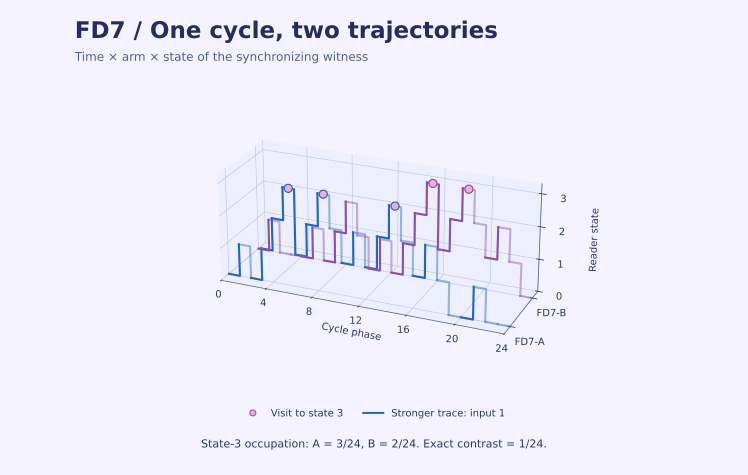

# ChronoWitness

[Castellano](README.es.md) · [SuperGraph](https://facundofirmenich.github.io/ChronoWitness/supergraph.html?lang=en) · [Interactive FD7 render](https://facundofirmenich.github.io/ChronoWitness/render-fd7.html?lang=en) · [Downloads](https://github.com/FacundoFirmenich/ChronoWitness/releases)

ChronoWitness designs matched temporal inputs to test classes of models of cellular memory. Its FD7 schedules agree on cyclic word counts through order seven and on the stated two-state periodic mean identity. The exact witnesses show where readers with more states can distinguish the histories. The observation and inference contracts specify how a measured contrast can bear on that distinction.

## Start without Git

1. Download the native ZIP for your platform from Releases and extract the whole folder. Targets are Windows x64, Linux x64, and macOS for Apple Silicon or Intel. Use the target listed on the asset.
2. Open `START_HERE.bat` on Windows, `START_HERE.command` on macOS, or `START_HERE.sh` on Linux. The ChronoWitness executable in the same folder also opens the menu.
3. Type `en all` for the complete public core, `en 1,3` for a selection, or `en atlas` to explore. Results are written under `source/research/results` in a native package.

The native package bundles Python, numerical dependencies and target-specific C++ engines. The full run executes these engines and compares results with the distributed reference. The source build also checks compilation from C++17 source. Native binaries are unsigned. If your operating system does not allow them, use the source route in the [getting-started guide](docs/GETTING_STARTED.md).

| Block | Scope |
|---|---|
| 1 | Exact reader identities, phase balance, and reader/instrument checks |
| 2 | Finite reporting, delivery bounds, sequential inference, counts, and kinetic witness |
| 3 | Certified design margin, exact power, worked example, and controls |
| 4 | Frozen trajectory assay, Monte Carlo checks against independent references, and application interfaces |
| all | Complete public core and reference verification |
| atlas | Offline evidence map, guided reading, typed dependencies, and the exact FD7 trajectories |

## Inspect the results and their scope

- [Exact structure and thresholds](docs/SCIENTIFIC_RESULTS.md), [worked example](docs/WORKED_EXAMPLE.md) and [literature context](docs/LITERATURE_CONTEXT.md).
- [Observation contract](docs/ASSAY_GUIDE.md), [trajectory assay](docs/TRAJECTORY_ASSAY.md) and [figure reproduction](docs/FIGURE_REPRODUCTION.md).
- [Observed cellular calibration](docs/CELLULAR_OBSERVATIONS.md), [frozen prediction E9](research/e9-execution/E9_NUMERICAL_PROTOCOL.json), [transport E10](research/e10-transport/README.md), and [reserved acquisitions E11](research/e11-causal/README.md).

The cellular studies preserve local tail deterioration and unsupported jurisdictions. Their published input programs are different from a paired FD7/FD8 intervention. The native core reproduces the certificates and the assay simulations. The separate acquisition studies specify their own sources, prerequisites and computation.

The atlas distinguishes a reading sequence from scientific dependencies. In the argument view you can inspect all premises of a conjunction. The 3D witness shows phase, arm and reader state. Its exact state-3 occupation contrast is 1/24.

## Source route and citation

Use `Start-Windows.bat`, `Start-macOS.command` or `start-linux.sh` with Python 3.12 for the source menu. For the canonical complete source run, start Docker and choose `en all`, or run `python launch.py --mode full`. Use the [reproduction guide](docs/GETTING_STARTED.md) to select a route.

Facundo Firmenich, Pau Firmenich and León Firmenich. [Citation metadata](CITATION.cff) · [Archived v0.14.3 software](https://doi.org/10.5281/zenodo.24147203) · [All versions](https://doi.org/10.5281/zenodo.24117387). The DOI refers to the named archived version. The original code is [MIT licensed](LICENSE).
