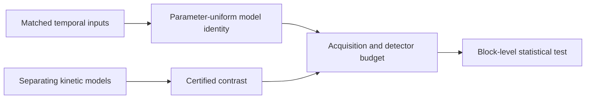

# ChronoWitness

**Temporal input design for testing models of cellular memory.**

ChronoWitness turns carefully matched input histories into quantitative tests of dynamical models. Its FD7 schedules share the same symbol counts, short-word statistics, run lengths and autocorrelations. Within the two-state promoter class, they must produce the same periodic mean response for every admissible choice of switching rates. A measured difference can therefore challenge that model class once delivery, observation and sampling have been accounted for.

The software connects that identity to exact state thresholds, kinetic constructions, reporter dynamics and sequential inference. Every reported computational result is accompanied by a reproducible calculation or certificate.



## Start with the scientific example

From a checkout of this repository:

```sh
python research/design_frontier/tutorial.py
```

The example verifies the two-state polynomial identity, evaluates a kinetic promoter exactly, transports its mean through a linear reporter, and reads the certified three-state contrast. It then connects an explicitly defined observation model to a conservative sample-size calculation. It uses the Python standard library and requires no experimental dataset.

Continue with the [worked example and assay guide](docs/WORKED_EXAMPLE.md), or inspect the [results and their assumptions](docs/SCIENTIFIC_RESULTS.md).

## What the method establishes

| Question | Result |
|---|---|
| Can matched short-word statistics hide a temporal distinction? | FD7 matches cyclic word counts through order seven while retaining a reader-dependent distinction. |
| How many deterministic states are needed? | Four, for the phase-balanced occupation-profile law used here. |
| How many positive Markov or kinetic states are needed? | Three; all two-state readers in the stated occupation classes share the null. |
| Does reporter dynamics preserve the null? | A common stable linear cascade preserves periodic mean equality. Finite windows admit endpoint corrections or transient bounds. |
| Can acquisition and detection change the contrast? | Delivery errors, hidden endpoints and saturation enter an explicit observation budget. |
| Can an experiment stop when evidence is sufficient? | The bounded-block test supports optional stopping under its conditional range and mean contracts. |

The design study also searches a fixed positive-generator domain and certifies the selected rational candidate independently. [Data S12](research/supplement-v011/data/) contains the search record, interval certificate and exact power calculations. These distinguish the existence of a separator, the size of its contrast and the performance of a specified statistical design.

## Reproduce the results

The complete verification runs on Linux with Python 3.12 and a C++17 compiler:

```sh
python reproduce_release.py
```

This command rebuilds the mathematical results, checks the new interval certificate and exact first-crossing probabilities, and compares the outputs with the distributed references. The [GitHub Actions workflow](.github/workflows/reproduce.yml) executes the same procedure.

The numerical search is a separate, reproducible step:

```sh
python -m pip install -r requirements-search.txt
python research/design_frontier/search.py
```

Its protocol fixes the parameter domain, objective, seeds and evaluation budget. Numerical proposals are assessed by rational interval certification. The search record includes termination status for every seed.

## Choose a route through the repository

- **Understand the method:** [scientific results](docs/SCIENTIFIC_RESULTS.md) and [worked example](docs/WORKED_EXAMPLE.md).
- **Design an observation:** [assay requirements and decision path](docs/ASSAY_GUIDE.md).
- **Inspect the evidence:** [data dictionary](research/supplement-v010/DATA_DICTIONARY.md), Data S1–S11 in their versioned directories, and [Data S12](research/supplement-v011/data/).
- **Extend the calculation:** exact reader code in `research/analysis/`, observation bounds in `research/finite_reporter/` and `research/input_robustness/`, count envelopes in `research/count_tails/` and `research/translation_counts/`, and tests in `research/statistical_inference/`.
- **Audit a release:** `RELEASE_MANIFEST.json` records file hashes; release assets include the source distribution and its checksum.

The repository supplies theoretical and computational research. Applying the test to cells requires the assay-specific rates or bounds, observation model and experimental units described in the guide.

## Cite and reuse

Research and software by **Facundo Firmenich**. Citation metadata is available in [CITATION.cff](CITATION.cff); release metadata is supplied for GitHub–Zenodo archiving.

The code is distributed under the **MIT License**. See [LICENSE](LICENSE). The academic manuscript and supplementary document are maintained separately.
