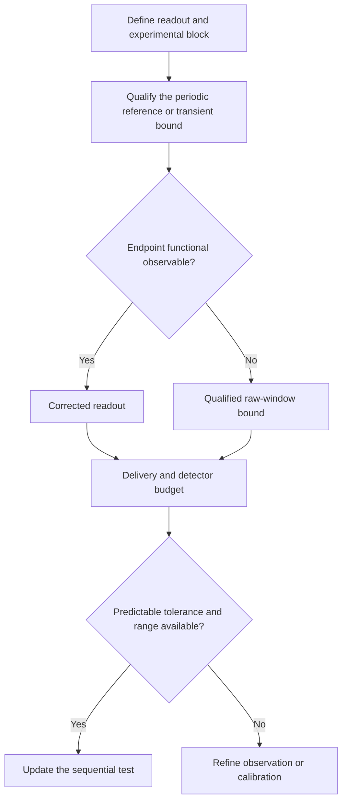

# From the model identity to an assay

Use this guide to determine which quantities must be supplied before a measured contrast enters the test.

| Decision | Information required | Consequence |
|---|---|---|
| Define the comparison | Same FD7 symbols, pulse duration, estimand and arm-wise observation rule | Establishes the quantity to which the identity applies |
| Choose the experimental block | Assignment unit, pairing, dependence and aggregation weights | Determines the score and the information available before each block |
| Control finite acquisition | Initial-state bounds, wash-in and observation window | Produces a transient allowance |
| Choose corrected or raw readout | Endpoint functional and measured endpoint channels | Selects endpoint correction or a raw-window bound |
| Qualify delivery | Per-arm amplitude/timing envelopes over the relevant history | Bounds displacement from the reference dynamics |
| Qualify detection | Response map, caps, gains and conditional count envelopes | Bounds saturation and other declared observation distortions |
| Declare the test inputs | Predictable mean tolerance and almost-sure range | Makes the bounded-block test available |
| Interpret a rejection | The full model-and-observation hypothesis and attribution controls | Separates model exclusion from identification of a biological mechanism |

The tolerance is a conditional-mean allowance; the support radius is not a standard deviation. If the tolerance is at least the support radius, that block cannot increase the supplied betting capital. Increasing a detector cap can reduce clipping bias while increasing the radius. More wash-in or a longer window can reduce transient terms while increasing acquisition time.

Known reporter rates and comparison bounds play different roles. For a constant translation model, known rates `(gamma, kappa, delta)` can be dominated by bounds satisfying `g <= gamma`, `k >= kappa`, `d <= delta`. The endpoint correction uses the known mean matrix; the count envelope can use conservative bounds.

A delivery trace revealed during the current block is not automatically a predictable tolerance. Using it in the test requires an appropriate conditional argument. The software checks numerical contracts; the experiment supplies their physical justification.
